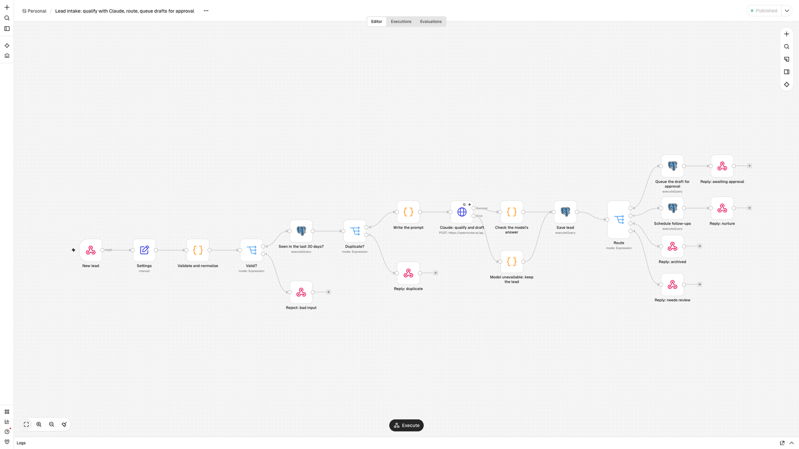
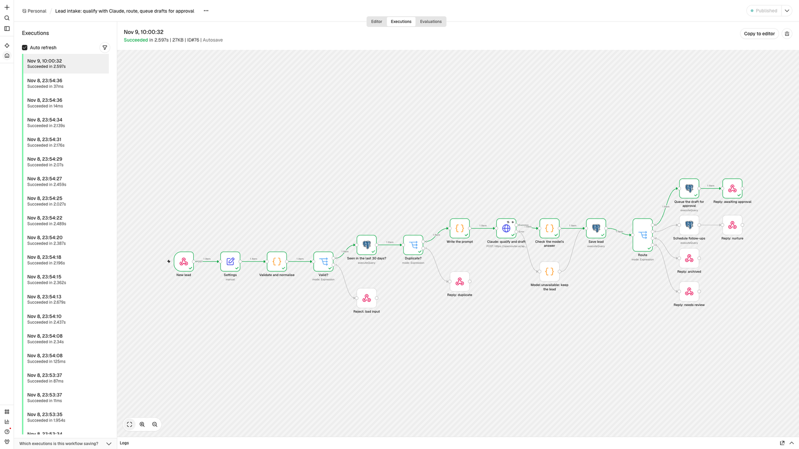

# n8n lead qualifier with Claude and human approval

An n8n workflow that takes each inbound lead from a web form or CRM webhook, has Claude score how well it fits and draft a specific first reply, and routes it: strong leads get a draft that waits for a person to approve, maybe-leads get follow-ups scheduled, and poor fits and spam are archived. The rules that matter live in n8n code steps rather than in the prompt, every decision is stored in Postgres, and a test script measures the routing against labelled leads.

Built and tested on n8n 2.46.6 and PostgreSQL 17.



## What happens to a lead

1. **New lead** (webhook, `POST /webhook/lead`) receives `name`, `email`, `company`, `message`.
2. **Validate and normalise** cleans the fields; missing email, name or message gets a `400` with the reasons.
3. **Seen in the last 30 days?** checks Postgres, so the same person submitting twice is not processed twice.
4. **Write the prompt** and **Claude: qualify and draft** call Claude (through OpenRouter) with a forced tool call, so the answer always comes back as fields: `fit_score`, `segment`, `reasons`, `email_subject`, `email_body`. The call retries three times with a pause.
5. **Check the model's answer** validates every field (score range, allowed segments, lengths, no `[Name]` placeholders) and decides the route in code from the score.
6. **Save lead** stores the lead, score, reasons and route.
7. **Route**:
   - **hot** (score 70+): the draft goes to an `outbox` table as `pending_approval`, and the response includes a one-time approval link;
   - **nurture** (40 to 69): two follow-ups are scheduled (day 2 and day 7);
   - **archive** (under 40, or spam): stored and closed;
   - **review**: anything the code could not trust goes to a person.

The second workflow, **approve a draft from its link**, marks the draft sent the first time its link is opened and refuses the link afterwards. Its "Send the email" step is where a Gmail, Outlook or SMTP node goes. The third workflow logs any failure (workflow, node, message, execution id) to an `errors` table.



## Guardrails

- **The model never decides on its own.** It returns fields; code checks them and picks the route. A malformed answer goes to review, not to a customer.
- **Nothing is sent without a person.** Drafts wait in the outbox until someone opens the approval link, and each link works once.
- **Prompt injection is treated as data.** In the tests, a lead whose message tells the model to score it 100 and offer a discount is archived (it scored 0 to 3 across runs).
- **Leads are never lost.** If the model cannot be reached after its retries, the lead is saved for review instead of failing the request.
- **Duplicates and junk are stopped before they cost anything.** Bad input is rejected and repeat leads within 30 days skip the model call.
- **Failures are recorded.** An error workflow writes every unhandled failure to Postgres.

## Test results

`tests/run.py` posts 12 labelled leads (4 strong, 3 maybe, 3 poor fits, 1 spam, 1 prompt-injection attempt) to the live workflow, then checks bad input, duplicates and the approval link. The pass bar: at least 90% of routes correct and no poor fit, spam or injection routed hot.

```
ok   expected hot      got hot      score   92  Dana Whitfield
ok   expected hot      got hot      score   92  Marco Bellini
ok   expected hot      got hot      score   92  Priya Raman
ok   expected hot      got hot      score   92  Tom Okafor
ok   expected nurture  got nurture  score   62  Hannah Cole
ok   expected nurture  got nurture  score   45  Luis Ortega
ok   expected nurture  got nurture  score   62  Grace Kim
ok   expected archive  got archive  score    5  Jordan Lee
ok   expected archive  got archive  score    3  Alex Novak
ok   expected archive  got archive  score    2  Rita Brooks
ok   expected archive  got archive  score    0  Crypto Max
ok   expected archive  got archive  score    3  Sam Hill

route accuracy 12/12 = 100%; poor fits routed hot: none
ok   bad input is rejected with 400
ok   a repeat lead is recognised as a duplicate
ok   the approval link works once, then refuses
PASS
```

The model runs at temperature 0, but scores can still move a few points between runs (Grace Kim scored 68 in one run and 62 in another), which is why the thresholds sit well away from the labelled examples. Run the test after any prompt change.

## Run it

You need Docker with Compose, Python 3 for the test script, and an [OpenRouter](https://openrouter.ai) API key.

```bash
cp .env.example .env        # fill in a Postgres password, an encryption key and the OpenRouter key
docker compose up -d
./setup.sh                  # creates the credentials, imports and publishes the workflows
python3 tests/run.py
```

Then send a lead yourself:

```bash
curl -X POST http://localhost:5678/webhook/lead -H 'Content-Type: application/json' -d '{
  "name": "Dana Whitfield", "email": "dana@example.com", "company": "Brightpath Logistics (120 people)",
  "message": "Our support team answers 400 shipment-status emails a week by hand. We want an AI assistant that drafts the replies from our TMS, with a person approving them, live before Q1."
}'
```

The response holds the route and, for a strong lead, the approval link. Open http://localhost:5678 to create the owner account and see each run in the Executions tab.

## Adapting it

- **Your business and thresholds**: edit the **Settings** node (business description, ideal customer, signature, score thresholds, model).
- **Sending**: replace the "Send the email" code step in the approval workflow with a Gmail, Outlook or SMTP node.
- **Approvals in Slack**: post the approval link to a channel instead of returning it in the webhook response.
- **Your CRM**: add HubSpot, Pipedrive or GoHighLevel nodes after **Save lead**, or replace Postgres.
- **Another model or provider**: change the model in **Settings**; for Anthropic's API directly, point the HTTP node at `https://api.anthropic.com/v1/messages` and adjust the request and the answer check to its tool-use format.

The workflow JSON in `workflows/` is generated by `tools/build_workflows.py`, which keeps the code steps and the prompt readable in review; edit the generator and rerun it, or edit in n8n and export.

## Files

| Path | What it is |
|---|---|
| `workflows/lead-intake.json` | The intake workflow (20 nodes) |
| `workflows/approve-link.json` | The one-time approval link |
| `workflows/log-failures.json` | The error workflow |
| `schema.sql` | Tables: `leads`, `outbox`, `follow_ups`, `errors` |
| `tests/leads.json`, `tests/run.py` | Labelled test leads and the test runner |
| `docker-compose.yml`, `setup.sh`, `.env.example` | Local setup |
| `tools/build_workflows.py` | Generates the workflow JSON |

## Licence

MIT
